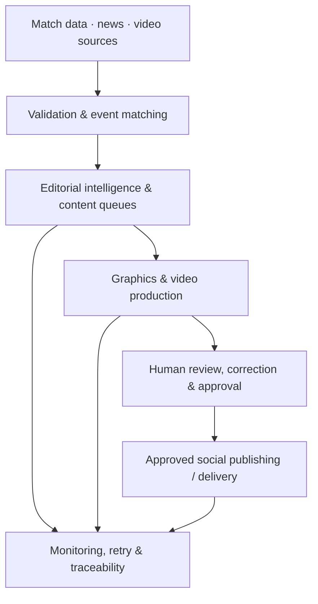

# TACTIC AI Media Production Platform

**A live, multi-pipeline AI media operation — production case study**  
**Architecture & automation:** Badreldin Mohamed Awad  
**Status:** Operating in production · **Source code:** Proprietary / not included here

> **One operating system. Multiple media products.** TACTIC transforms football match data, editorial leads and video sources into branded news, graphics, analysis, matchday content, and video deliverables. It combines automated processing with human editorial review.

[**Explore published TACTIC work ↗**](https://x.com/TacticSpoort) · [**Explore AMER's public Snapchat ↗**](https://www.snapchat.com/@amer.aaa) · [**Production evidence ↓**](#production-evidence) · [**Content examples ↓**](#selected-real-world-outputs)

---

## At a glance

| Verified operational snapshot | Recorded volume |
| :-- | --: |
| Content jobs in **rendered** state | **3,091** |
| Publishing queue records in **published** state | **837** |
| Indexed source videos in the X media vault | **3,517** |
| Registered motion media assets | **403** |
| Publishing records in the previous seven days | **96** |

*Read-only database snapshot: **23 November 2026**. Counts refer to distinct operational records, **not** unique social impressions, total account posts, videos successfully published to Snapchat, or measured time saved. See [evidence definitions](docs/PRODUCTION_EVIDENCE.md).*

## What the platform produces

| Production stream | Examples |
| :-- | :-- |
| **Match intelligence** | Starting XIs, match statistics, results, player-of-the-match cards |
| **Round & competition intelligence** | Team of the round, player rankings, goal/assist/shot/pass/dribble leaders, league tables and upcoming fixtures |
| **AI newsroom** | News briefs, transfer updates, club developments, deduplicated editorial cards |
| **Editorial features** | Data patterns, tactical analysis, historical features, player profiles and explainers |
| **AMER-branded production** | Separately branded matchday fixtures, results and editorial visuals |
| **Motion & video** | Source-video monitoring, goal-media collection, match-linked video assets, reel rendering and Telegram delivery |

The streams have different readiness and publishing rules. **A produced asset is not automatically a published social post.**

## Visual examples from live production

The images below are **already-published TACTIC outputs**, linked to their corresponding public X posts. They are hotlinked from the existing public output files; **no original photos or footage are redistributed in this repository**.

| Starting XI | Match statistics | Player of the match | News |
| :--: | :--: | :--: | :--: |
|  |  |  |  |

*If external image previews are blocked by GitHub or Google Drive, follow the linked X posts to view the originals.*

## Selected real-world outputs

These are links to **published TACTIC posts**, not mockups:

| Example | Public proof |
| :-- | :-- |
| Match statistics | [Published match-stats card](https://x.com/TacticSpoort/status/2124629151449583946) |
| Starting lineup | [Published lineup graphic](https://x.com/TacticSpoort/status/2124483139678384632) |
| Player of the match | [Published player card](https://x.com/TacticSpoort/status/2124582742360764647) |
| League standings | [Published league table](https://x.com/TacticSpoort/status/2124245056773058993) |
| Team of the round | [Published best-XI graphic](https://x.com/TacticSpoort/status/2119499245065519230) |
| Round figures | [Published round-stats card](https://x.com/TacticSpoort/status/2124216319578894649) |
| News production | [Published news post](https://x.com/TacticSpoort/status/2124641048093733372) |

**AMER / Snapchat:** the operation includes dedicated AMER-branded daily fixtures/results and video-preparation flows. [View the public @amer.aaa Snapchat profile](https://www.snapchat.com/@amer.aaa). The public profile is provided as a brand reference, **not** proof that every video is uploaded automatically.

For a broader breakdown, see the [content gallery and production taxonomy](docs/CONTENT_GALLERY.md).

## How it works

This is an **intentionally high-level** diagram. Internal decision rules, workflow exports, provider integrations, credentials, database structure and production endpoints are not public.

## Why this is an engineering project

- Designed around **separate ingestion, decision, production and delivery stages**, rather than a single automation script.
- Uses **database-backed task state, retry paths and deduplication controls** to support ongoing production.
- Integrates **AI editorial assistance with human approvals** before sensitive publishing decisions.
- Produces **multiple branded content families** from shared operational data.
- Coordinates **video/media handling and specialist rendering services**, not just text generation.
- Provides **inspectable production evidence** and separates delivered, rendered and published status.

**Technology categories:** n8n · PostgreSQL/Supabase · LLM APIs · REST APIs/webhooks · cloud file storage · Telegram review flows · social publishing integrations · containerized media services.

## Transferability beyond sports

The underlying pattern — *capture → classify → validate → generate → review → execute → monitor* — applies to customer intake, document processing, recruitment operations, e-commerce and business reporting. This is a **transferability illustration**, not a claim that those specific workflows are part of TACTIC.

## Documentation

- [Public architecture and reliability notes](docs/ARCHITECTURE.md)
- [Real content formats and links](docs/CONTENT_GALLERY.md)
- [Evidence, metric definitions and limitations](docs/PRODUCTION_EVIDENCE.md)
- [Security, intellectual-property and disclosure boundaries](docs/SECURITY_AND_SCOPE.md)

---

**Disclosure:** This is a **public case study** of an actively operated proprietary system, not a source-code release, setup guide, licensed data feed or invitation to access production. Brand media and public links are shown as examples of output; rights to individual underlying photographs or footage may belong to their respective owners.
