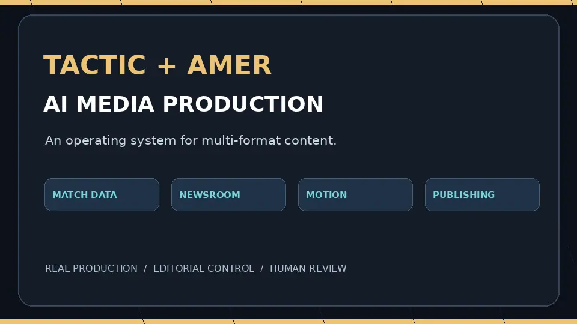
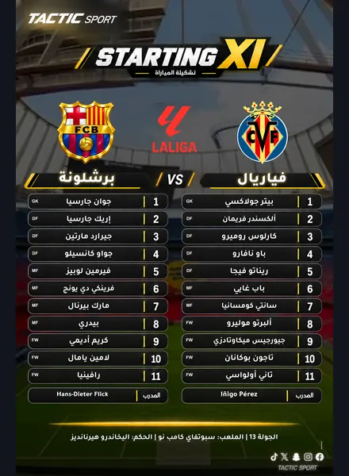
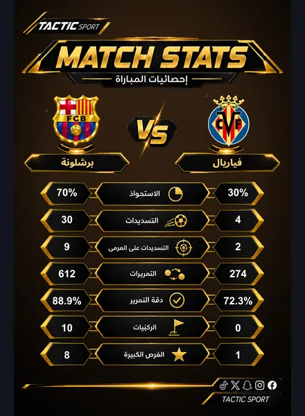
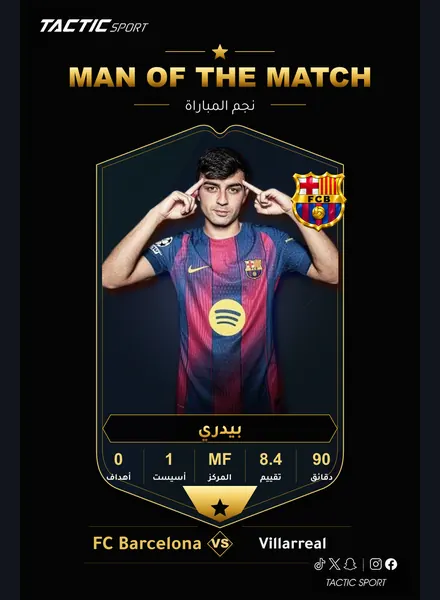
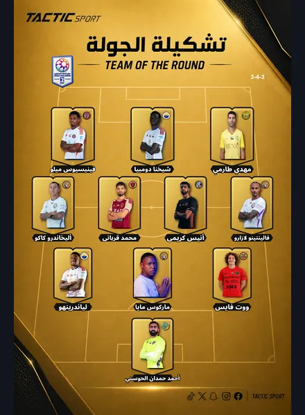
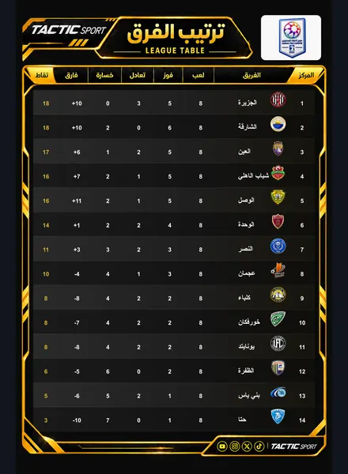
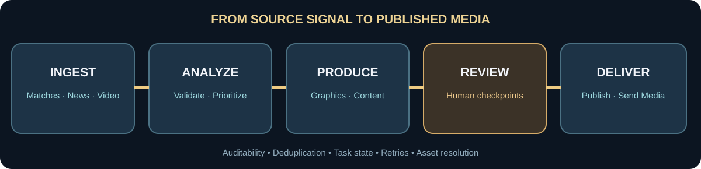

<div align="center">


**A production AI automation case study, not a workflow template.**

[](https://x.com/TacticSpoort)
[](docs/SECURITY_AND_SCOPE.md)
[](docs/SECURITY_AND_SCOPE.md)

[**90-second tour for recruiters**](docs/RECRUITER_TOUR.md) · [**Published work**](https://x.com/TacticSpoort) · [**Architecture**](docs/ARCHITECTURE.md) · [**AMER on Snapchat**](https://www.snapchat.com/@amer.aaa)

</div>

---

## A digital media team — operating as a system

I designed and operate interconnected AI-driven workflows that transform **live sports data, editorial news signals, and video sources** into multiple branded media outputs.

The platform handles the coordination between **collection → qualification → editorial decisions → content and media production → human review → publishing or delivery**, with task tracking and recovery.

Instead of showcasing hundreds of automation nodes, this repository shows the **real outputs**, **engineering decisions**, and **publicly verifiable evidence** of an operating media system.

## 15-second visual tour

<div align="center">



*Animated preview assembled from six resized examples of **already-published** TACTIC artwork; this is a static portfolio selection, not a live dashboard or a demonstration of automated Snapchat posting.*

</div>

**▶ [Play the 60-second silent overview video](assets/tactic-showreel.mp4)** · [Follow the 90-second nontechnical tour](docs/RECRUITER_TOUR.md)

*The MP4 is a narrated-by-on-screen-text portfolio montage made from selected published graphic outputs and explanatory slides — not a screen recording of the full production UI or a claim of automated Snapchat uploads.*

## Production snapshot

| **3,091** | **837** | **3,517** | **403** |
| :--: | :--: | :--: | :--: |
| Rendered content jobs | Records marked published | Indexed source videos | Motion media assets |

**96 publishing records in the prior seven days.**

*Read-only operational snapshot taken **23 November 2026**. These are recorded states/counts, **not** unique social posts, views, revenue, measured staff hours saved, or successful Snapchat uploads. Full [metric definitions](docs/PRODUCTION_EVIDENCE.md).*

## Actual production gallery

Click any preview to see the **original published X post**. All six thumbnails are downsized previews of existing published TACTIC content, rather than stock images.

<table>
<tr>
<td width="33%" align="center"><a href="https://x.com/TacticSpoort/status/2124483139678384632"></a><br/><strong>Starting XI</strong><br/><sub>Matchday lineups</sub></td>
<td width="33%" align="center"><a href="https://x.com/TacticSpoort/status/2124525366769234248"></a><br/><strong>Match statistics</strong><br/><sub>Head-to-head analytics</sub></td>
<td width="33%" align="center"><a href="https://x.com/TacticSpoort/status/2124530161156510070"></a><br/><strong>Player of the match</strong><br/><sub>Performance cards</sub></td>
</tr>
<tr>
<td width="33%" align="center"><a href="https://x.com/TacticSpoort/status/2124535428401266694"></a><br/><strong>AI newsroom</strong><br/><sub>Branded editorial cards</sub></td>
<td width="33%" align="center"><a href="https://x.com/TacticSpoort/status/2119499245065519230"></a><br/><strong>Team of the round</strong><br/><sub>Round-level intelligence</sub></td>
<td width="33%" align="center"><a href="https://x.com/TacticSpoort/status/2124245056773058993"></a><br/><strong>League table</strong><br/><sub>Competition intelligence</sub></td>
</tr>
</table>

**[Browse additional formats and public evidence →](docs/CONTENT_GALLERY.md)**

## One match, several distinct outputs

A single monitored event can generate multiple complementary products. The **Barcelona–Villarreal** example in this gallery provides three identifiable published artifacts:

```text
Match scheduled
    │
    ├── Starting XI / team lists  ──► Published graphic
    │
    └── Match data updated
          ├── Match statistics ─────► Published graphic
          └── Player performance ───► Player-of-match card
```

See the [starting XI](https://x.com/TacticSpoort/status/2124483139678384632), [match statistics](https://x.com/TacticSpoort/status/2124525366769234248), and [player-of-the-match](https://x.com/TacticSpoort/status/2124530161156510070) posts. This is an illustrative **real production lineage**, not a promise that every match always produces every format.

## Six connected production capabilities

| Production domain | What happens | Demonstrable output |
| :-- | :-- | :-- |
| **1. Match intelligence** | Monitor scheduled/live match data and create relevant match-specific jobs | Lineups, results, stats, star cards |
| **2. Round & league analysis** | Aggregate competition/round data into recurring formats | Best XI, statistics leaders, standings, next fixtures |
| **3. AI newsroom** | Intake sports leads, assess relevance, detect duplicates, write Arabic content | Branded news cards and posts |
| **4. Editorial intelligence** | Propose and develop data-led or editorial story angles | Player features, club stories, transfer analysis, VAR and tactical explainers |
| **5. Multi-brand creative output** | Produce content with separate brand templates and correction flows | TACTIC graphics; AMER fixtures/results/news visuals |
| **6. Motion and delivery** | Catalog media, associate goal videos with events, prepare vertical content, deliver MP4 | Goal-related video deliverables and Telegram handoff |

**Human approvals are part of the product design.** Rendering, editorial approval, delivery and actual social publication are distinct lifecycle states.

### AMER — dedicated brand workflows

The platform also supports separately branded **AMER** matchday fixtures/results, editorial corrections and vertical video preparation. Related services receive video links or uploaded media, render formatted content and can deliver it to Telegram for the publishing operator.

[**View public AMER Snapchat profile**](https://www.snapchat.com/@amer.aaa).

> Important: I have verified **video preparation and Telegram delivery workflows**, but not automatic posting to Snapchat. This case study does **not** represent Snapchat publication as fully automated or claim that every content family is posted automatically.

## Architecture — understandable at a glance



- **Orchestration:** separate specialized automation services and event-driven workflows.
- **Operational state:** database-backed jobs, status transitions, reservations, retries, and audit trails.
- **Editorial layer:** AI-assisted selection and writing with duplicate detection and human oversight.
- **Media layer:** managed lookup and recovery paths for required imagery and videos.
- **Delivery layer:** publishing queue, editorial approval, social posting and video handoff.

**Stack categories:** n8n · PostgreSQL / Supabase · LLM APIs · JavaScript · REST / Webhooks · Google Drive · Telegram · social publishing APIs · containerized media services.

[**Read the architecture and failure-handling notes →**](docs/ARCHITECTURE.md)

## Engineering challenges solved

- **Reliability at multiple stages:** a task can wait for missing data or media without being treated as successful.
- **Idempotency & duplicates:** repeated events and callbacks require stable identities and guardrails.
- **Human-in-the-loop:** editors can approve, reject, correct text or replace visual assets.
- **Media orchestration:** asset search, missing-asset intake, rendering and delivery are decoupled.
- **Two brand identities:** shared infrastructure can serve different content standards and templates.
- **Operational observability:** task stages and delivery outcomes are recorded and inspectable.

## Why this matters beyond sports

The same engineering method applies to sales, document intake, customer operations, e-commerce and internal reporting:

`Observe → Validate → Decide → Generate → Approve → Execute → Monitor`

This is an illustration of transferable architecture, **not** a claim that those other industry workflows are part of this specific platform.

## Explore the documentation

| Document | Why it matters |
| :-- | :-- |
| [90-second recruiter tour](docs/RECRUITER_TOUR.md) | Fast, nontechnical tour with published examples |\n| [Engineering case study](docs/ENGINEERING_CASE_STUDY.md) | Design decisions, reliability and transferability |\n| [Production evidence](docs/PRODUCTION_EVIDENCE.md) | Metrics, date, source and limitations |
| [Content taxonomy and post links](docs/CONTENT_GALLERY.md) | The actual range of output families |
| [Architecture](docs/ARCHITECTURE.md) | Reliability, workflow separation and review |
| [Security and disclosure](docs/SECURITY_AND_SCOPE.md) | What is intentionally excluded |

---

### Security and ownership

**This is a public case study, not an open-source release.** Production workflow exports, private APIs, service credentials, internal endpoints, commercial selection rules and confidential operating information are not included. Portfolio previews are resized from already public branded posts; source photography, footage and third-party rights remain with their respective owners. No raw source-video files are distributed.

**Author / systems engineering:** Badreldin Mohamed Awad · [GitHub portfolio](https://github.com/Badrna3om)

