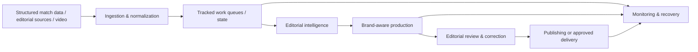

# Architecture — Public Overview

## System pattern

**Illustrative only.** Component boundaries are simplified to avoid exposing proprietary implementation.

## Production concerns addressed

| Concern | Architectural approach |
| :-- | :-- |
| Repeated source events | Event identity and deduplication controls |
| Partial or missing match facts | Validation and content-readiness rules |
| Unavailable player/team imagery | Managed media lookup and missing-asset routing |
| Concurrent rendering | Queue state and execution reservation |
| Editorial mistakes | Preview, correction and human approval |
| Delivery failures | Status tracking, retries and recovery paths |
| Multiple media brands | Branded templates and separate delivery paths |

## Operational separation

The deployed solution includes **two specialized workflow orchestration environments** and auxiliary containerized media services. The public diagram intentionally abstracts away internal service names, hostnames, webhooks, task schedules, table names and third-party data providers.

## Human-in-the-loop

Editorial operators may approve, skip, or correct content, including replacement of missing or unsuitable imagery. A verified published record is a separate stage from successful rendering.

## Reuse across business domains

`Input event → Validate → Classify → Prepare → Approve → Execute → Audit` is suitable for high-volume document workflows, lead qualification, recruitment handling, e-commerce operations and internal reporting.

## Not included

This document **does not** disclose actual workflow JSON, AI prompt text, connector configuration, private endpoint URLs, database schemas, account identifiers, client information, vendor contracts or credentials.
